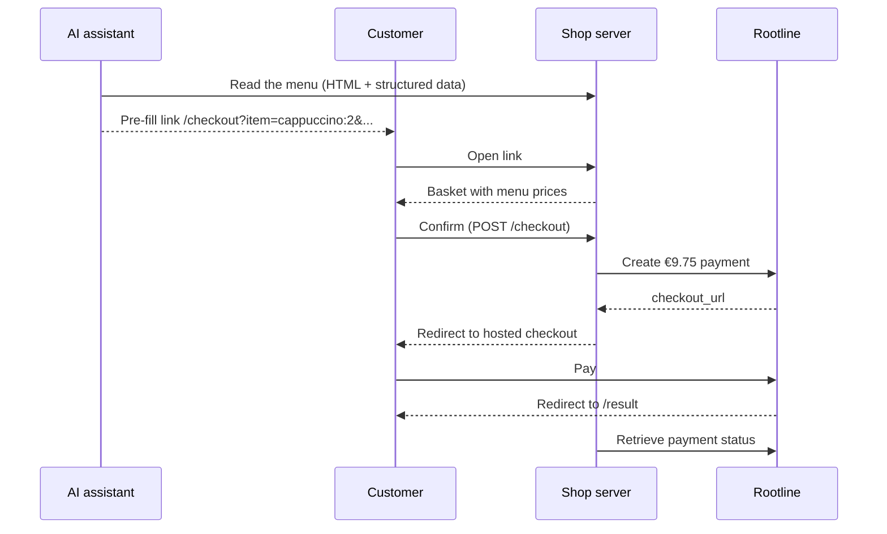

# Make your checkout agent-ready

[← Rootline overview](../../README.md) · [Create your first payment](../api/) · [Embed checkout](../checkout/) · [Onboard a merchant](../onboarding/) · [Collect platform fees](../saas/)

AI assistants help customers decide what to buy: which items, how many, for which date. This example shows how an existing shop lets an assistant hand that decision over with a **pre-fill link**: a link that opens the shop's own checkout with the basket already filled. The customer reviews the order and pays in Rootline's hosted checkout. The shop needs no agent-specific integration, and every agent that can read a web page can use it.

The example is a small café shop: a Node server with no dependencies that renders its own pages. The approach is described in [Filling the basket: your first step into agentic commerce](https://rootline.com/blog/filling-the-basket-your-first-step-into-agentic-commerce?utm_source=github&utm_medium=readme&utm_campaign=github&utm_content=agentic).

## Run in preview mode

Preview mode runs locally without Rootline credentials. It requires **Node 24**; there is nothing to install.

```bash
npm run preview
```

Open the pre-fill link an assistant would send: [http://localhost:3000/checkout?item=cappuccino:2&item=croissant:1&ref=concierge-bot](http://localhost:3000/checkout?item=cappuccino:2&item=croissant:1&ref=concierge-bot). The basket shows two cappuccinos and a croissant. Select **Pay €9.75**, then choose an outcome in the simulated checkout.

Preview mode sends no requests to Rootline. A banner on every page indicates this.

## How it works



An existing shop needs four changes.

### 1. Publish the catalog in a form agents can read

Agents read pages as text, often without running JavaScript. The menu at `/` is plain HTML, and it also includes the items as [schema.org](https://schema.org/Product) structured data with ID, price, currency, and an order link per item:

```json
{
  "@type": "Product",
  "sku": "cappuccino",
  "name": "Cappuccino",
  "offers": {
    "@type": "Offer",
    "price": "3.50",
    "priceCurrency": "EUR",
    "url": "http://localhost:3000/checkout?item=cappuccino:1"
  }
}
```

If your shop renders in the browser, serve the catalog and prices in the initial HTML as well.

### 2. Document a predictable checkout link

The link format is described on every page of the shop, so an agent that lands anywhere can find it:

```
/checkout?item=<item>:<quantity>&ref=<your-name>
```

- `item`: an item ID from the menu and a quantity from 1 to 10. Repeat it for each item.
- `ref` (optional): identifies who sent the customer, for example `concierge-bot`.

### 3. Treat link parameters as untrusted

Anyone can write a link, so [src/basket.ts](./src/basket.ts) rebuilds the basket on the server:

- Only known item IDs and quantities from 1 to 10 are accepted. Repeated items are added up.
- Prices always come from the menu. A `price` or `amount` parameter in the link has no effect.
- An invalid link shows what is wrong and lists the available items, so an agent can correct it.
- Opening a link only shows the basket. Link previews, crawlers, and agents fetch links too, so a `GET` request never creates a payment. The payment is created when the customer confirms.

### 4. Create the payment and redirect to hosted checkout

When the customer confirms, [src/server.ts](./src/server.ts) validates the basket again and creates the payment with the [Payment API](https://docs.rootline.com/guides/payments/payment-api?utm_source=github&utm_medium=readme&utm_campaign=github&utm_content=agentic):

```typescript
const reference = `cafe-${basket.ref}-${randomUUID().slice(0, 8)}`;
const payment = await gateway.create({
  reference,
  amount: euros(basket.total),
  returnUrl: `${config.origin}/result?order=${reference}`,
});
orders.set(reference, payment.id);
return redirect(payment.checkoutUrl);
```

Hosted checkout shows the payment methods enabled for your account, such as cards, wallets, and iDEAL. When the customer returns, the server retrieves the payment status; the redirect alone does not confirm payment.

The `ref` from the link becomes part of the payment reference, for example `cafe-concierge-bot-1a2b3c4d`. Search for it in the dashboard to see which sales came through an agent.

## Connect a staging account

Stop the preview server. Staging mode requires:

1. Access to the [staging dashboard](https://dashboard.staging.rootline.com), Rootline's test environment.
2. An API key for an API user with the `PaymentApi` role. See [API keys](https://docs.rootline.com/guides/get-started/api-keys?utm_source=github&utm_medium=readme&utm_campaign=github&utm_content=agentic).
3. A platform account ID from **Accounts**.

Copy the example configuration, set `ROOTLINE_API_KEY` and `ROOTLINE_ACCOUNT_ID`, and start the server:

```bash
cp .env.example .env
npm run dev
```

Open the same pre-fill link and pay with the [test card details](https://docs.rootline.com/guides/payment-methods/cards/cards?utm_source=github&utm_medium=readme&utm_campaign=github&utm_content=agentic).

To try it with an assistant, make the server reachable with a tunnel, for example `ngrok http 3000`. Set `APP_ORIGIN` in `.env` to the tunnel URL and restart `npm run dev`. Then ask the assistant to read the menu at the tunnel URL and send you an order link.

### Project structure

| File                                 | Responsibility                                                    |
| ------------------------------------ | ----------------------------------------------------------------- |
| [src/menu.ts](./src/menu.ts)         | Menu items and prices.                                            |
| [src/basket.ts](./src/basket.ts)     | Parses and validates pre-fill links.                              |
| [src/pages.ts](./src/pages.ts)       | HTML pages, structured data, and the order link description.      |
| [src/server.ts](./src/server.ts)     | Routes: menu, basket, payment creation, and result.               |
| [src/rootline.ts](./src/rootline.ts) | Payment API requests, and the simulated checkout used in preview. |
| [src/index.ts](./src/index.ts)       | Starts the server in preview or staging mode.                     |

## Tests

```bash
npm test
```

The tests use simulated Rootline responses and require no credentials.

## Next steps

- [Embed checkout in your app](../checkout/): keep the customer on your own page with Checkout Components instead of hosted checkout.
- [Collect platform fees](../saas/): on a SaaS platform, route the agent's sale to the merchant and collect a platform fee.
- [Agentic commerce on Rootline](https://rootline.com/agentic-commerce?utm_source=github&utm_medium=readme&utm_campaign=github&utm_content=agentic)

Questions about this example or Rootline? [Contact Rootline](https://rootline.com/contact/sales?utm_source=github&utm_medium=readme&utm_campaign=github&utm_content=agentic).
