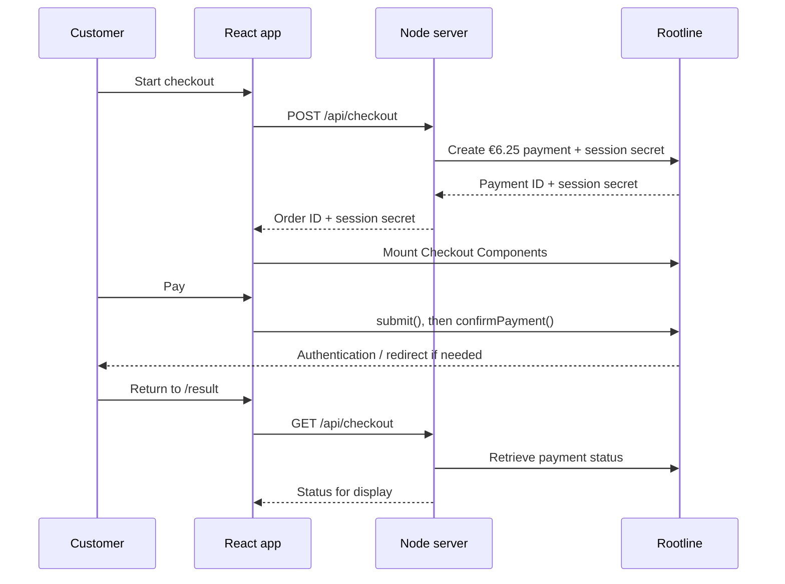
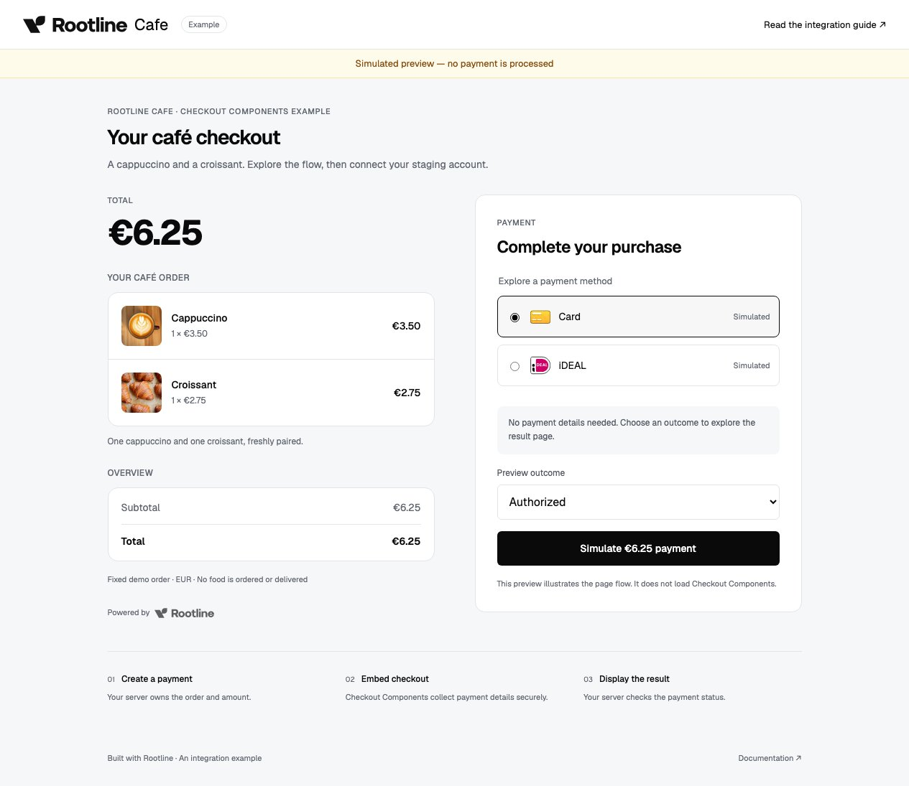

# Embed checkout in your app

[← Rootline overview](../../README.md) · [Create your first payment](../api/) · [Onboard a merchant](../onboarding/) · [Collect platform fees](../saas/) · [Agent-ready checkout](../agentic/)

A **React + TypeScript** application that adds embedded payments with [Checkout Components](https://docs.rootline.com/guides/payments/components/standard-flow?utm_source=github&utm_medium=readme&utm_campaign=github&utm_content=checkout), Rootline's embeddable payment form. A Node server creates the payment; Checkout Components collect payment details and confirm the payment in the browser. The interface is styled after [Rootline Cafe](https://rootline.cafe).

## How it works

1. **The server creates the payment.** It sets the amount, account, order reference, and return URL, and requests a session secret with `create_payment_session_secret: true`. The amount is never taken from the browser.
2. **The browser mounts Checkout Components** using the session secret.
3. **The customer pays.** Checkout Components handle 3D Secure (Strong Customer Authentication under PSD2) and bank redirects such as iDEAL, then return the customer to the result page.
4. **The server retrieves the payment status** for display.

The browser side:

```typescript
// Load https://js.rootline.com/js/rootline.js first.
// paymentSessionSecret comes from your server's payment creation response.
const rootline = new Rootline({ locale: "en" });
const components = rootline.components("checkout", { paymentSessionSecret });
const methods = components.create("payment-methods-list", {
  only: ["visa", "mastercard", "amex", "ideal"],
});
methods.mount("#payment-methods");

// Inside the pay handler, with the button disabled:
const submitted = await components.submit();
if (!submitted.error && !submitted.cancelled) {
  const result = await rootline.confirmPayment({ components });
  // Handle result.error, result.cancelled, and redirects before showing status.
}
```

[LiveCheckout.tsx](./src/LiveCheckout.tsx) contains the complete implementation, including error handling, duplicate-submit prevention, and redirect handling. [server/rootline.ts](./server/rootline.ts) contains the server-side payment creation.



## Run in preview mode

Preview mode runs locally without Rootline credentials. It requires **Node 24**. The first `npm ci` installs the React and test tooling and takes about a minute.

```bash
npm ci
npm run preview
```

Open [http://localhost:5173](http://localhost:5173) and select **Start checkout**. Choose Card or iDEAL, then select an outcome (authorized, pending, or declined) to see how the application handles it.

Preview mode is a simulation: it sends no requests to Rootline and collects no card details. A banner on the page indicates this.



## Connect a staging account

Stop the preview server. Staging mode requires:

1. Access to the [staging dashboard](https://dashboard.staging.rootline.com), Rootline's test environment.
2. An API key for an API user with the `PaymentApi` role. See [API keys](https://docs.rootline.com/guides/get-started/api-keys?utm_source=github&utm_medium=readme&utm_campaign=github&utm_content=checkout).
3. A platform account ID from **Accounts**, with card and iDEAL enabled.
4. `localhost` in that account's allowed domains. See [Account configuration](https://docs.rootline.com/guides/payments/components/account-configuration?utm_source=github&utm_medium=readme&utm_campaign=github&utm_content=checkout).

Copy the example configuration, set `ROOTLINE_API_KEY` and `ROOTLINE_ACCOUNT_ID`, and start the server:

```bash
cp .env.example .env
npm run dev
```

Open **http://localhost:5173** and select **Start checkout**. Use the [test card details](https://docs.rootline.com/guides/payment-methods/cards/cards?utm_source=github&utm_medium=readme&utm_campaign=github&utm_content=checkout) or the staging iDEAL flow. If configuration is incomplete, the application displays setup instructions.

The API key is used only by the server. Do not commit `.env` or prefix the key with `VITE_`; Vite exposes `VITE_` variables to the browser.

## Receive webhooks

Rootline sends a webhook whenever a payment changes status. Webhooks are the reliable signal for fulfilling orders, because a customer may close the browser before returning to the result page. The example receives them at `POST /api/webhooks`.

1. Make the local server reachable from the internet with a tunnel, for example `ngrok http 5173` or `cloudflared tunnel --url http://localhost:5173`.
2. In the staging dashboard, go to **Developer → Webhooks**, select **Create new endpoint**, enter `<tunnel URL>/api/webhooks`, and select the payment events for your account.
3. Copy the endpoint's HMAC secret into `.env` as `ROOTLINE_WEBHOOK_SECRET` and restart `npm run dev`.

For each request, the server:

1. Computes an HMAC-SHA256 signature over the raw request body with the secret, and compares it with the `rootline-signature` header. Requests with a missing or invalid signature are rejected with `401`.
2. Updates the order that matches the event's payment ID and reference. Applying the same event twice has no further effect, so redelivered events are safe.
3. Responds with `200` and the body `accepted`. Rootline retries unacknowledged events.

Verified events are logged, for example `Webhook payment.succeeded: order cafe_… is succeeded.` See [server/webhooks.ts](./server/webhooks.ts) and the `/api/webhooks` route in [server/api.ts](./server/api.ts). For event types and payloads, see [Webhook events](https://docs.rootline.com/guides/webhooks/events?utm_source=github&utm_medium=readme&utm_campaign=github&utm_content=checkout).

## Project structure

| File                                                 | Responsibility                                          |
| ---------------------------------------------------- | ------------------------------------------------------- |
| [server/product.ts](./server/product.ts)             | Fixed demo order and price.                             |
| [server/rootline.ts](./server/rootline.ts)           | Requests to the Rootline staging API.                   |
| [server/checkout.ts](./server/checkout.ts)           | Order state and payment status tracking.                |
| [server/api.ts](./server/api.ts)                     | Local API endpoints, session cookie, and origin checks. |
| [server/webhooks.ts](./server/webhooks.ts)           | Webhook signature verification and event parsing.       |
| [src/LiveCheckout.tsx](./src/LiveCheckout.tsx)       | Checkout Components mounting and submission.            |
| [src/PreviewCheckout.tsx](./src/PreviewCheckout.tsx) | Simulated checkout used by `npm run preview`.           |
| [src/App.tsx](./src/App.tsx)                         | Order summary, setup screen, and result page.           |

Orders are stored in memory. Restarting the server clears them; payments already created in Rootline are unaffected.

## Troubleshooting

| Symptom                                | Check                                                                                                                                                     |
| -------------------------------------- | --------------------------------------------------------------------------------------------------------------------------------------------------------- |
| Setup screen instead of a payment form | Both values are set in `.env`, and `npm run dev` was restarted.                                                                                           |
| API request rejected                   | The API key, the `PaymentApi` role, and access to the account.                                                                                            |
| Payment form does not load             | `localhost` is an allowed domain on the account, and `js.rootline.com` and `js.staging.rootline.com` are reachable.                                       |
| Payment method missing                 | The method is enabled on the account. `only` filters available methods; it does not enable them. Cards are listed by brand: `visa`, `mastercard`, `amex`. |
| Status remains `open`                  | Checkout is not complete. Return to checkout, retrieve the status again, or start a new order.                                                            |

## Tests

```bash
npm run typecheck
npm test
npx playwright install chromium
npm run test:e2e
```

The tests use simulated Rootline responses and require no credentials.

## Next steps

- [Collect platform fees](../saas/): route this payment to a merchant on your platform and collect a platform fee.
- [Make your checkout agent-ready](../agentic/): let AI assistants send customers to checkout with a filled basket.
- Before going live, review the [go-live checklist](https://docs.rootline.com/guides/references/checklist?utm_source=github&utm_medium=readme&utm_campaign=github&utm_content=checkout) with Rootline.
- Documentation: [Standard flow](https://docs.rootline.com/guides/payments/components/standard-flow?utm_source=github&utm_medium=readme&utm_campaign=github&utm_content=checkout) · [Appearance](https://docs.rootline.com/guides/payments/components/appearance?utm_source=github&utm_medium=readme&utm_campaign=github&utm_content=checkout) · [Payment statuses](https://docs.rootline.com/guides/payments/payment-statuses?utm_source=github&utm_medium=readme&utm_campaign=github&utm_content=checkout)

Questions about this example or Rootline? [Contact Rootline](https://rootline.com/contact/sales?utm_source=github&utm_medium=readme&utm_campaign=github&utm_content=checkout).
