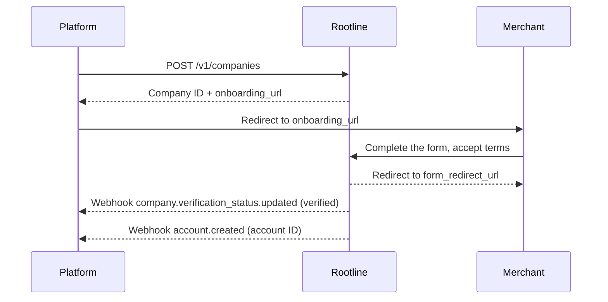

# Onboard a merchant

[← Rootline overview](../../README.md) · [Create your first payment](../api/) · [Embed checkout](../checkout/) · [Collect platform fees](../saas/) · [Agent-ready checkout](../agentic/)

This guide onboards a merchant onto your platform with the [Config API](https://docs.rootline.com/guides/onboarding/onboard-a-company?utm_source=github&utm_medium=readme&utm_campaign=github&utm_content=onboarding). You create the merchant's company, send the merchant to Rootline's hosted onboarding form, and receive the account ID once the merchant is verified. Rootline collects identity, bank account, and VAT details and runs the verification; your platform builds no form.



## Prerequisites

- Access to the [staging dashboard](https://dashboard.staging.rootline.com). Staging is Rootline's test environment and processes no real funds.
- An API key for an API user with access to the Config API, created under **Developers → API users**. See [API keys](https://docs.rootline.com/guides/get-started/api-keys?utm_source=github&utm_medium=readme&utm_campaign=github&utm_content=onboarding).
- `curl`, or Node.js 18 or later.

## Create the company

A company is the merchant's legal entity. Replace `YOUR_API_KEY` with your staging API key and `https://example.com/onboarding/complete` with the page the merchant returns to after the form:

```bash
curl https://config-api.staging.rootline.com/v1/companies \
  --request POST \
  --header 'content-type: application/json' \
  --header 'x-api-key: YOUR_API_KEY' \
  --header 'rootline-version: 2024-04-23' \
  --data '{
    "legal_name": "Rootline Cafe B.V.",
    "trade_name": "Rootline Cafe",
    "address": { "city": "Amsterdam", "country": "NL" },
    "reference": "cafe-merchant-001",
    "form_redirect_url": "https://example.com/onboarding/complete"
  }'
```

- `legal_name` is the only required field.
- `reference` is your own ID for the merchant. It is returned on every company and account event.
- `business_registration_number`, when provided, pre-fills the merchant's form from the business register.
- `form_redirect_url` must be `https`. Without it, the merchant stays on Rootline's confirmation page after submitting.

Example response (abbreviated):

```json
{
  "id": "co_example",
  "legal_name": "Rootline Cafe B.V.",
  "reference": "cafe-merchant-001",
  "verification_status": "created",
  "next_action": {
    "type": "provide_information",
    "onboarding_url": "https://onboarding.rootline.com/your-platform/companies/co_example"
  }
}
```

Store the company `id` with your merchant record.

## Send the merchant to the onboarding form

Redirect the merchant to `next_action.onboarding_url`. The form collects the legal identity, owners, bank account, VAT number, and supporting documents, and the merchant accepts Rootline's terms of service. On staging, the form accepts test values:

| Field             | Test value                                                                |
| ----------------- | ------------------------------------------------------------------------- |
| IBAN              | Any IBAN with check digits `00`, for example `NL00RABO0000000000`         |
| VAT number        | Any number whose national part is all zeros, for example `NL000000000000` |
| Identity document | Any file that is not a real ID document                                   |

When the merchant submits, the company moves from `created` to `open`, and the merchant lands on your `form_redirect_url`. The link stays valid for the lifetime of the company; a verified merchant opens the same link to update bank account or VAT details later.

## Track verification

Retrieve the company at any time. Replace `COMPANY_ID` with the `id` from the response:

```bash
curl https://config-api.staging.rootline.com/v1/companies/COMPANY_ID \
  --header 'x-api-key: YOUR_API_KEY' \
  --header 'rootline-version: 2024-04-23'
```

| `verification_status` | Meaning                                                                                |
| --------------------- | -------------------------------------------------------------------------------------- |
| `created`             | You created the company. The merchant has not submitted the form yet.                  |
| `open`                | The merchant submitted the form. Verification is in progress.                          |
| `verified`            | The merchant is approved and can transact.                                             |
| `not_accepted`        | The merchant was rejected. Final.                                                      |
| `suspended`           | No response, a duplicate onboarding, or a failed review. You can request reactivation. |

While a company is `open` or `verified`, `next_action` may ask the merchant for more information. Its `type` is then `provide_information`, and `onboarding_url` is the link to forward to the merchant.

On staging, verification completes automatically once the form is submitted. In production, Rootline's operations team reviews every company.

For production, subscribe to [webhooks](https://docs.rootline.com/guides/webhooks/configure-webhooks?utm_source=github&utm_medium=readme&utm_campaign=github&utm_content=onboarding) instead of polling:

| Event                                 | When it fires                                                                   |
| ------------------------------------- | ------------------------------------------------------------------------------- |
| `company.verification_status.updated` | The status changed, for example `open` to `verified`.                           |
| `company.next_action.updated`         | Rootline needs more information from the merchant, or the request was cleared.  |
| `account.created`                     | The merchant's account exists and can process payments. Carries the account ID. |

## Use the account

Rootline creates the merchant's account when the company is verified. The `account.created` event carries its `id`, prefixed `acc_`, together with `legal_entity_id` (the company) and your `reference`. The account is also listed in the staging dashboard under **Accounts**.

```json
{
  "event_type": "account.created",
  "account": {
    "id": "acc_example",
    "legal_entity_id": "co_example",
    "reference": "cafe-merchant-001"
  }
}
```

Store the account `id` with your merchant record. In [Collect platform fees](../saas/), this is `YOUR_MERCHANT_ACCOUNT_ID`.

## Skip the form on staging

To get a verified merchant account without opening the form, set `scenario=instant_allowance` as the company's `description`:

```bash
curl https://config-api.staging.rootline.com/v1/companies \
  --request POST \
  --header 'content-type: application/json' \
  --header 'x-api-key: YOUR_API_KEY' \
  --header 'rootline-version: 2024-04-23' \
  --data '{
    "legal_name": "Rootline Cafe B.V.",
    "description": "scenario=instant_allowance",
    "reference": "cafe-merchant-002"
  }'
```

Rootline fills in standard test details, verifies the company, and creates the account immediately. Staging only; the parameter has no meaning in production.

## Next steps

- [Collect platform fees](../saas/): route a payment to this merchant and collect a platform fee.
- [Embed checkout in your app](../checkout/): collect payments on your own page with Checkout Components.
- Documentation: [Onboard a company](https://docs.rootline.com/guides/onboarding/onboard-a-company?utm_source=github&utm_medium=readme&utm_campaign=github&utm_content=onboarding) · [Accounts](https://docs.rootline.com/guides/onboarding/accounts?utm_source=github&utm_medium=readme&utm_campaign=github&utm_content=onboarding) · [Webhook events](https://docs.rootline.com/guides/webhooks/events?utm_source=github&utm_medium=readme&utm_campaign=github&utm_content=onboarding)

Questions about this example or Rootline? [Contact Rootline](https://rootline.com/contact/sales?utm_source=github&utm_medium=readme&utm_campaign=github&utm_content=onboarding).
