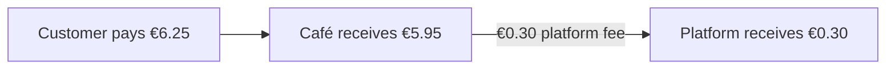

# Collect platform fees in your SaaS

[← Rootline overview](../../README.md) · [Create your first payment](../api/) · [Embed checkout](../checkout/) · [Onboard a merchant](../onboarding/) · [Agent-ready checkout](../agentic/)

This guide collects a platform fee on a payment that a merchant accepts through your software. The example is an ordering platform for cafés: the café is a merchant on your platform, the café's customer pays an order, the full amount goes to the café's account, and your platform keeps a fee per order. Both are defined in the request that creates the payment, using [splits](https://docs.rootline.com/guides/payments/split-a-payment-to-a-seller?utm_source=github&utm_medium=readme&utm_campaign=github&utm_content=saas) and [platform fees](https://docs.rootline.com/guides/fees-and-revenue/platform-fees?utm_source=github&utm_medium=readme&utm_campaign=github&utm_content=saas).

## Fund flow



| Account         | Allocation from this payment |
| --------------- | ---------------------------- |
| Café (merchant) | **€5.95**                    |
| Platform (you)  | **€0.30** platform fee       |

The full payment is split to the café's account. The platform fee then transfers €0.30 from the café to your platform. Rootline processing fees are charged to your platform account, not to the merchant. The platform fee covers those costs and your margin.

## Prerequisites

- A staging **platform account**. This is your SaaS company's account.
- A **merchant account** onboarded under the platform. [Onboard a merchant](../onboarding/) shows how to create one; on staging, the `instant_allowance` scenario in that guide gives you a verified merchant account in one request.
- An API user permitted to create payments for both accounts.
- The merchant's account ID, available in the dashboard under **Accounts**, or from the `account.created` webhook in the onboarding guide.

## Create the payment with a split and a fee

This is the request from [Create your first payment](../api/) with a `splits` array added. Replace `YOUR_API_KEY` with your staging API key, `YOUR_PLATFORM_ACCOUNT_ID` with your platform account ID, and `YOUR_MERCHANT_ACCOUNT_ID` with the café's account ID:

```bash
curl https://payment-api.staging.rootline.com/v1/payments \
  --request POST \
  --header 'content-type: application/json' \
  --header 'x-api-key: YOUR_API_KEY' \
  --header 'rootline-version: 2024-04-23' \
  --data '{
    "account_id": "YOUR_PLATFORM_ACCOUNT_ID",
    "reference": "cafe-demo-001",
    "amount": { "currency": "EUR", "quantity": "6.25" },
    "return_url": "https://example.com/result",
    "splits": [
      {
        "account_id": "YOUR_MERCHANT_ACCOUNT_ID",
        "reference": "cafe-demo-001-merchant",
        "amount": { "currency": "EUR", "quantity": "6.25" },
        "fees": [
          {
            "fee_type": "platform_fee",
            "flat_rate": { "amount": { "currency": "EUR", "quantity": "0.30" } }
          }
        ]
      }
    ]
  }'
```

- The top-level **`account_id`** is your platform account, which receives the platform fee.
- **`splits`** allocates all or part of the payment to other accounts. Here, the full €6.25 is allocated to the café. Any amount that is not split stays on the platform account.
- **`fees`** deducts a platform fee from that split: a flat €0.30 per order.

Split the full amount and deduct the fee from it. A €5.95 split combined with a €0.30 fee would leave the café €5.65.

The same request serves every merchant on your platform. Only `splits[].account_id` changes per merchant, so the fee logic lives in one place in your code.

With [Checkout Components](../checkout/), also add `create_payment_session_secret: true`.

The response contains `next_action.checkout_url`. Open it in a browser and pay with the [test card details](https://docs.rootline.com/guides/payment-methods/cards/cards?utm_source=github&utm_medium=readme&utm_campaign=github&utm_content=saas), as in the first guide.

## Merchant of record

Fund allocation and merchant of record are configured separately. On a SaaS platform, the merchant is usually the business the customer buys from: the café's name is on the receipt, and the café answers customer questions and complaints about the payment. The card schemes then consider the merchant the **merchant of record**. In that case, set the top-level `processing_account_id` to the merchant's account ID:

```json
"account_id": "YOUR_PLATFORM_ACCOUNT_ID",
"processing_account_id": "YOUR_MERCHANT_ACCOUNT_ID",
```

Rootline routes the transaction to the card networks under the merchant. The split and the fee stay as above. See [Processing accounts](https://docs.rootline.com/guides/payments/processing-accounts?utm_source=github&utm_medium=readme&utm_campaign=github&utm_content=saas).

For Checkout Components, add your application's domain to the allowed domains of the processing account: the platform account by default, or the merchant account when it is the merchant of record. See [Account configuration](https://docs.rootline.com/guides/payments/components/account-configuration?utm_source=github&utm_medium=readme&utm_campaign=github&utm_content=saas).

## Store the identifiers

The response contains separate IDs for:

- the root payment,
- **each split**, which is a payment on the merchant's account,
- **each fee**.

Store all of them with the order. Refunds, captures, and fee updates each target a specific object; the root payment ID cannot be used in place of a split's payment ID. A fee can be updated after the payment by its fee ID.

Use [webhooks](https://docs.rootline.com/guides/webhooks/configure-webhooks?utm_source=github&utm_medium=readme&utm_campaign=github&utm_content=saas) to keep your systems in sync, and reconcile payments and fees per merchant against Rootline reporting.

## Next steps

- [Embed checkout in your app](../checkout/): collect the payment inside your platform with Checkout Components instead of hosted checkout.
- [Onboard a merchant](../onboarding/): add the next merchant to your platform.
- [Make your checkout agent-ready](../agentic/): let AI assistants send customers to checkout with a filled basket.
- Documentation: [Split a payment to a seller](https://docs.rootline.com/guides/payments/split-a-payment-to-a-seller?utm_source=github&utm_medium=readme&utm_campaign=github&utm_content=saas) · [Platform fees](https://docs.rootline.com/guides/fees-and-revenue/platform-fees?utm_source=github&utm_medium=readme&utm_campaign=github&utm_content=saas) · [Processing accounts](https://docs.rootline.com/guides/payments/processing-accounts?utm_source=github&utm_medium=readme&utm_campaign=github&utm_content=saas)

Questions about this example or Rootline? [Contact Rootline](https://rootline.com/contact/sales?utm_source=github&utm_medium=readme&utm_campaign=github&utm_content=saas).
